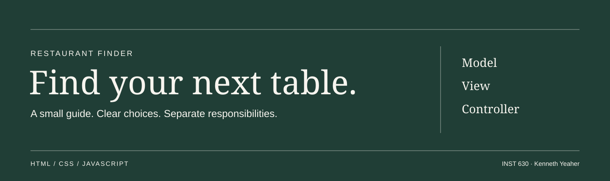
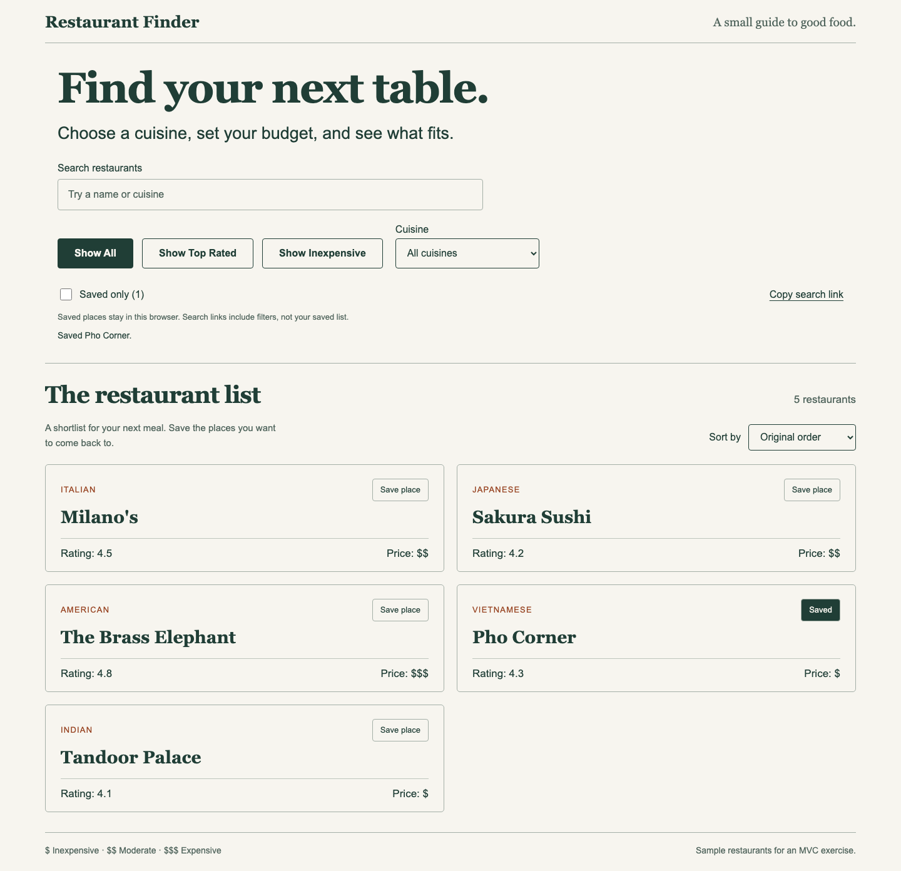
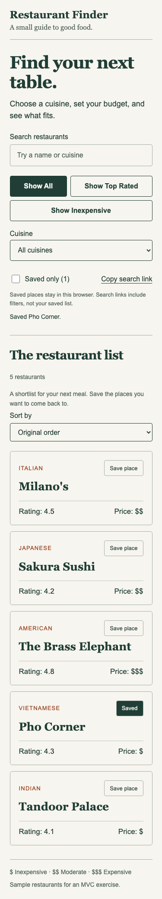
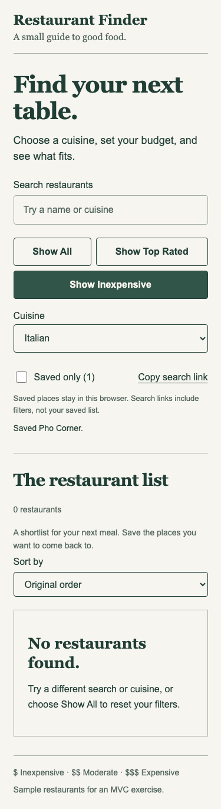
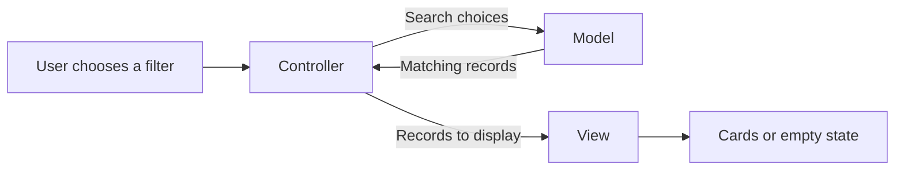

<p align="center">
  
</p>

<p align="center">
  <strong>A restaurant guide built around a clear separation of responsibilities.</strong><br>
  Search by name or cuisine, compare prices and ratings, save a shortlist, and share a filtered view.
</p>

<p align="center">
  
  
  
  <a href="https://github.com/kennethyeaher/mvcWebApp/actions/workflows/checks.yml"></a>
  
</p>

<p align="center">
  <a href="https://kennethyeaher.github.io/mvcWebApp/"><strong>Explore the guide ↗</strong></a> &nbsp; · &nbsp;
  <a href="#class-requirements">Class requirements</a> &nbsp; · &nbsp;
  <a href="answers.md">MVC answers</a> &nbsp; · &nbsp;
  <a href="#run-locally">Run locally</a>
</p>

---

## The interaction

An INST 630 assignment extended into a small discovery tool with live search, sorting, a persistent shortlist, and shareable search state. The required price data, inexpensive filter, and reusable cuisine search remain in the Model. The original five restaurant names, cuisines, and ratings remain intact. Price ranges are sample values added for the exercise.



<details>
<summary><strong>See the mobile layout and empty state</strong></summary>
<br>
<p align="center">
  
  
</p>
</details>

## Beyond the class brief

| Extension | Behavior | Engineering decision |
| --- | --- | --- |
| **Live search and sorting** | Search names or cuisines; order by rating, price, name, or the original list | Query normalization and sorting stay in the Model; source records keep their original order |
| **Saved places** | Save individual restaurants and filter to a shortlist; reload without losing it | Stable IDs, versioned storage, schema checks, and validation against known records |
| **Cross-tab synchronization** | Saving in one tab updates another tab | Storage events refresh results while preserving keyboard focus |
| **Shareable search links** | Open a link to restore search, cuisine, price/rating filter, and sort order | URL parameters are validated; saved IDs and the device-specific saved filter are excluded |
| **Recoverable browser failures** | Save for the current visit when storage fails; manually copy a link when clipboard access fails | Explicit feedback, bounded stored data, and guards against delayed clipboard results showing an outdated link |
| **Regression coverage** | Class behavior and extensions run on every push | Model tests, adapter boundary tests, browser scenarios, and continuous integration |

These additions keep the app small enough to inspect directly. No framework, backend, account system, or production dependency is needed. The sample data is intentionally limited to the five course records; this is a demonstration of interaction and architecture rather than a live restaurant directory.

## Try the filters

1. Open the guide. All five restaurants appear initially.
2. Choose **Show Inexpensive**. Pho Corner and Tandoor Palace remain because their price range is `$`.
3. Select **Italian** while that filter is active. The empty state explains how to recover.
4. Choose **Show All** to reset both controls, then **Show Top Rated** to see Milano's and The Brass Elephant.
5. Select a cuisine to narrow the current filter. Choosing **All cuisines** removes only the cuisine restriction.

To explore the extensions, type **Pho** into search, save Pho Corner, and select **Saved only**. Reload to check persistence, then open a second tab and change the saved selection to see both tabs update. Use **Show All** to reset the discovery controls without deleting saved places. Sort by **Highest rated** or **Price: low to high** to compare the sample list.

Choose **Copy search link** to share the current discovery choices. If clipboard permission is unavailable, a selected field provides the link for manual copying. Search terms are included in the URL and may appear in browser history or hosting request logs. Saved restaurant IDs are kept in local storage and are never added to the generated search link; the saved-only checkbox is local to the current tab.

The price key below the list explains `$` inexpensive, `$$` moderate, and `$$$` expensive. Ratings are course sample data, not live review scores. This app does not find nearby restaurants, make reservations, or call an external service.

## MVC in practice



| Component | Owns | Example |
| --- | --- | --- |
| **[Model](model.js)** | Records, query rules, sort order, and saved membership | `getInexpensiveRestaurants()` checks `priceRange === "$"`; `getTopRatedRestaurants()` owns the `4.5` threshold |
| **[View](view.js)** | Cards, empty feedback, result count, and visible selection | `displayRestaurants()` renders whichever records it receives |
| **[Controller](controller.js)** | Events and current filter choices | `updateRestaurants()` passes current query state to the Model, then updates the View |

`getRestaurantsByCuisine(cuisine)` works independently. `getFilteredRestaurants(filter, cuisine)` reuses it with the named filter methods to support combined choices. `findRestaurants(options)` adds search, sorting, and saved-only filtering around those required methods. It returns display records with saved state without modifying the original records. The Controller contains no restaurant filtering rule, and the View never decides which restaurants qualify.

Two small adapters handle browser boundaries: [persistence.js](persistence.js) reads and writes versioned saved IDs, while [query-state.js](query-state.js) converts validated discovery choices to and from URLs. The Controller coordinates them with the Model. Keeping those boundaries separate makes blocked storage, malformed data, and URL round trips testable without a browser.

## Class requirements

| Assignment part | Implementation |
| --- | --- |
| Price data and explanation | All five Model records have `priceRange`; [answers.md](answers.md) explains why the field belongs there |
| Display price | Every restaurant card shows name, cuisine, rating, and price |
| Show inexpensive | The required `showInexpensive` button requests the Model's `$` filter |
| Reusable cuisine search | A labeled native select passes the cuisine to the Model's reusable function |
| Empty results | `displayRestaurants([])` shows **No restaurants found.** and recovery guidance |
| Written MVC responses | [answers.md](answers.md) contains the five responses and the MVC Detective correction |

All six assignment parts remain implemented, and the original requirement scenarios remain in the browser suite. The app keeps the required HTML, CSS, and vanilla JavaScript structure. Node.js and Playwright are used only for development checks; the app itself needs no installation or build.

## Interface decisions

The visual direction uses a printed restaurant guide as a reference: serif headings, fine dividing rules, a quiet green palette, and prices aligned consistently across cards. The two-column desktop list becomes a single column on mobile. System fonts keep the project self-contained.

Two patterns from *Designing Interfaces: Patterns for Effective Interaction Design*, 3rd edition, by Jenifer Tidwell, Charles Brewer, and Aynne Valencia informed the controls:

- **Good Defaults and Smart Prefills**, Chapter 10, PDF page 795: start with all restaurants and all cuisines, so the first visit shows useful results without input.
- **Escape Hatch**, Chapter 3, PDF page 291: keep **Show All** available as a predictable return to the complete list, especially after an empty result.

These are design applications of the patterns, not claims that the interface has been validated through a user study. Page positions refer to the supplied course PDF and may differ from printed pagination. The textbook and assignment PDF are not redistributed in this repository.

Filter buttons expose their selected state with `aria-pressed`. The cuisine select has a visible label, the result count uses a live status region, and a skip link and visible focus indicators support keyboard navigation. Restaurant strings are assigned through `textContent` instead of parsed as HTML.

## Run locally

Open `index.html` directly in a browser. The production app has no external fonts, image downloads, account requirements, or API keys.

For a local server, run this from the project folder:

```sh
python3 -m http.server 8000
```

Open **[localhost:8000](http://localhost:8000/)**.

## Verification

Use Node.js 22 or newer to run the development checks:

```sh
npm ci
npx playwright install chromium
npm run check
npm test
```

To run browser checks in an installed Chrome browser:

```sh
BROWSER_CHANNEL=chrome npm test
```

Seven Model tests, four adapter tests, and fourteen browser scenarios cover the behavior below. Node's report also counts the parent browser test, producing 26 passing test entries. The GitHub badge links to the current hosted result.

| Area | Coverage |
| --- | --- |
| Model | Price coverage, required filters, every cuisine, combined search, sort order, source preservation, saved membership, bounded query defaults |
| Browser adapters | Versioned storage, empty-list removal, invalid schemas, blocked or full storage, Unicode URL round trips, private-state exclusion |
| Required interactions | Initial results, price labels, all filter buttons, every cuisine, empty results, full reset |
| Keyboard and layout | Tab, Enter, Space, pressed states, 320 / 375 / 768 / 1440 px widths, enlarged text, forced colors, reduced motion preference |
| Rendering safety | Restaurant text containing markup stays literal text |
| Runtime | Direct local file use, browser error monitoring, JavaScript syntax checks |
| Saved state | Reload persistence, cross-tab changes, focus restoration, corrupt data, unknown IDs, current-visit fallback |
| Shared state | URL restoration, invalid choices, navigation events, clipboard denial, manual-copy focus, delayed resolution after the search changes |

Local checks passed in Chromium and Chrome. The desktop, mobile, and empty-state images above are actual Chromium captures. In-app browser checks also confirmed the filtering flow. Playwright supplied fixed viewport checks and screenshots because the in-app browser did not expose viewport resizing.

Safari, Firefox, and VoiceOver have not been tested. Automated checks do not establish full accessibility conformance. There is no live restaurant API or server database. Saved state is local to a browser profile, is not encrypted, and does not synchronize across devices. Direct file opening supports the app, but storage behavior depends on the browser and sharing requires the HTTP or HTTPS version.

<details>
<summary><strong>Manual review before submission</strong></summary>

1. Open `index.html` and check that all five cards show all four fields.
2. Select **Show Inexpensive**. Only the two `$` restaurants should remain.
3. Select each cuisine and check that the list changes.
4. Combine **Italian** with **Show Inexpensive**. Check the no-results message.
5. Select **Show All**. All five cards and **All cuisines** should return.
6. Select **Show Top Rated**. Check that only ratings of 4.5 or higher remain.
7. Repeat with Tab, Enter, and Space; inspect the browser console for errors.
8. Search for **Pho**, try each sort order, then reset with **Show All**.
9. Save a place, enable **Saved only**, reload, and change the saved list from a second tab.
10. Copy a search link and open it in another tab. Check that discovery choices return and saved-only is off.
11. Read `answers.md` and confirm that each explanation matches your understanding.

</details>

## Project structure

```text
mvcWebApp/
├── index.html                  # page structure and labeled controls
├── styles.css                  # layout, focus, and responsive rules
├── model.js                    # restaurant data and filter rules
├── view.js                     # cards, feedback, and control presentation
├── controller.js               # events and coordination
├── persistence.js              # versioned browser storage and recovery
├── query-state.js              # validated shareable URL state
├── answers.md                  # required MVC responses and correction
├── tests/                      # Model and browser checks
├── docs/assets/                # banner and actual screenshots
├── .github/workflows/          # repeatable hosted checks
└── package.json                # development tools only
```

## Source and submission

The original application came from the course's `INST_630_MVC_Homework_Starter_Code` folder. The first commit preserves its five application files. Later commits add the Model rules, interface, browser verification, written responses, and project documentation. The next feature commits add discovery and saved-state rules, connect the interface, and expand failure-path coverage.

The assignment requests a **ZIP**, so a GitHub link alone is not the complete submission. To create a ZIP from the committed application files:

```sh
git archive --format=zip --output=INST630_MVC_Kenneth_Yeaher.zip HEAD index.html styles.css model.js view.js controller.js persistence.js query-state.js answers.md
```

Extract the ZIP and open `index.html` to check it before uploading. This command includes the six required files plus the two supporting JavaScript adapters used by the extended app. It excludes development dependencies, screenshots, and Git history.

---

## Author

**Kenneth Yeaher**  
MS in Human Computer Interaction  
University of Maryland, College Park  
[](https://www.linkedin.com/in/kennethyeaher/)

`JavaScript` · `MVC` · `Browser State` · `Interaction Design` · `HTML and CSS`
